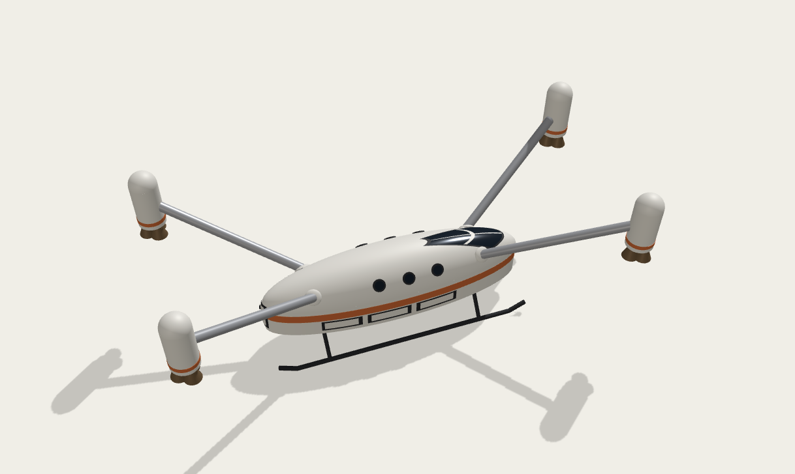

# Mars-local transportation challenge
No roads, variable and rugged terrain - rovers get stuck, humans can only go so far. Thin atmosphere makes aerodynamic flight difficult. Rockets work just fine, but require prepated launch and landing pads, unless engine thrust is impractically small. 

The solution is a ballistic hopper with the layout borrowed from multicopter drones - rocket engines mounted high above the body to dissipate exhaust during landings and ascents from unprepared ground. Both ascent and landing is done propulsively, with no reliance on aerobraking or aerogliding. (L/D ~ 1) See below for an example of design. Quad/Hex/Octo-hopper configuration can be also evaluated .

## Basic inputs / assumptions ##
- MTOW: 100 tonnes (wet)
- Structure: 15 tonnes
- Payload: 10 tonnes, 8 people.
- Propellant: 75 tonnes 
- Range: 150 km, two way (two ascents, two landings)
- Range: 600 km, ferry (one ascent, one landing)

## Propulsion and TWR
- Basics: 12x100kN methalox engines (4x3 in each engien pod) for 1.2 TWR on Earth, allowing flight-testing, 3.15 TWR on Mars, adding engine(s) out capability. 

